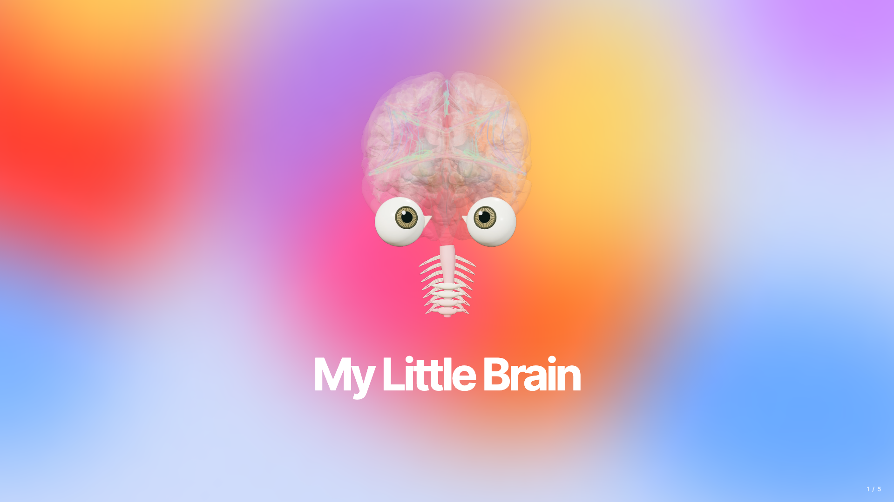
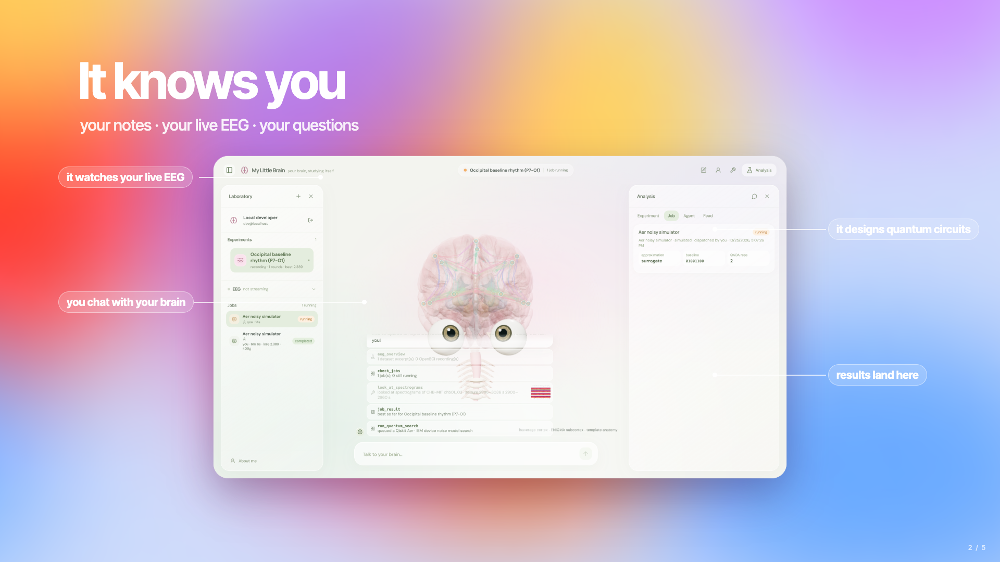
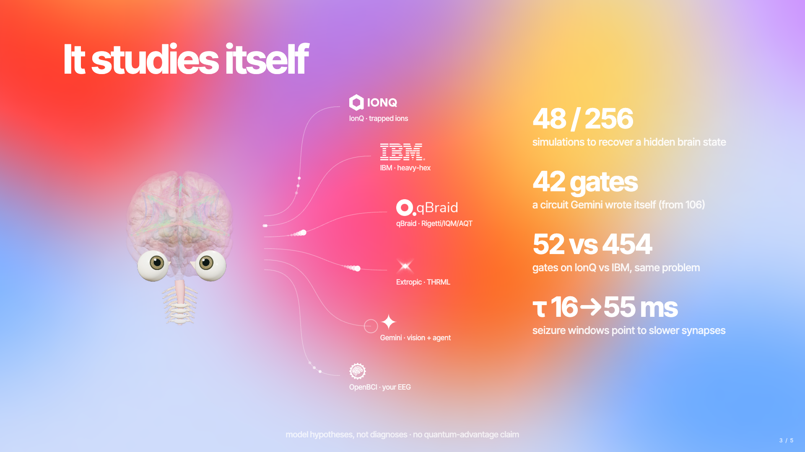
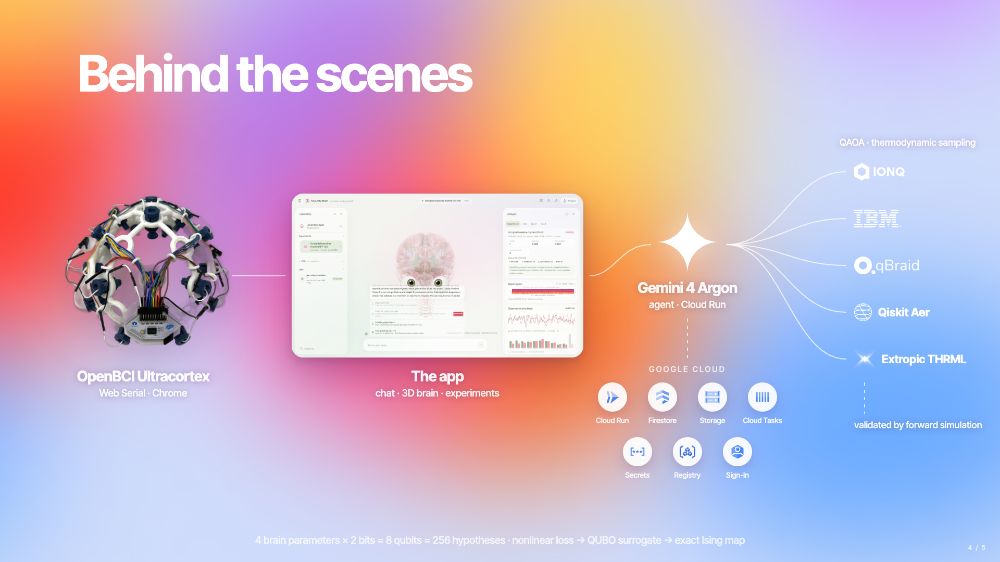
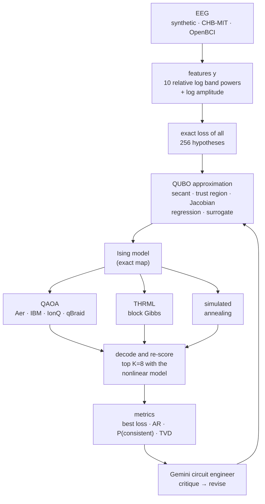

# My Little Brain · cortex²

> A chat agent with a brainy personality that knows you — your notes and your live EEG — and is obsessed with doing
> neuroscience research on you, using quantum infrastructure.

You talk to your brain. It reads your About-me notes, looks at your EEG spectrograms with Gemini vision, picks
channels, and dispatches searches that work backwards from the recording to the brain-model parameters that could have
produced it: QAOA circuits on IBM heavy-hex, IonQ trapped ions and qBraid multi-vendor QPUs/simulators, Extropic's THRML
thermodynamic sampler, and classical baselines. That research engine is **cortex²**. Its results are hypotheses about a
simplified model, not diagnoses.

**Live:** https://my-little-brain-563778990179.us-central1.run.app (sign in with Google)

<p align="center">
  <a href="https://youtu.be/c7H80NzR3Tg"></a>
  <br><sub>▶ <a href="https://youtu.be/c7H80NzR3Tg">Watch the 2-minute demo</a></sub>
</p>

<p align="center">
  
</p>
<p align="center">
  
  
</p>
<p align="center">
  
</p>
<p align="center">
  
</p>
<p align="center">
  
  
</p>
<p align="center"><sub>Pitch deck: <a href="media/deck.html">media/deck.html</a> (live, animated) · <a href="media/my-little-brain-deck.pdf">PDF</a></sub></p>

[What's inside](#whats-inside) · [How it works](#how-it-works) · [The math](#the-math) · [Results](#results) ·
[Claims](#what-we-claim-and-what-we-dont) · [Run it](#run-it) · [Deploy](#deploy-gcp) · [API](docs/cortex2-api.md)

---

## What's inside

| piece | what it does | where |
|---|---|---|
| **The app** | React + Vite: chat, 3D brain, analysis pane (landscape, circuits, histograms, waveforms), jobs sidebar | `apps/web` |
| **The brain** | three.js: 28 real fsaverage/ENIGMA template meshes (cortex, nuclei, cerebellum, brainstem, white matter), stylized eyes with a damped-spring gaze, blinking, moods, EEG/fiber overlay | `packages/brain` |
| **Brain chat agent** | "Your brain": reads your About-me docs, looks at EEG spectrograms, triages recordings, creates experiments, runs quantum searches, babysits jobs, remembers notes, sets its mood | `research/backend/cortex2/chat.py` |
| **cortex² lab** | 8-qubit inverse problem over a Wilson–Cowan neural-mass model, QUBO/Ising bridge, QAOA/THRML/annealing samplers, evaluation that can't be gamed | `research/backend/cortex2/` |
| **Circuit engineer** | Gemini 4 Argon agent: construct → compile → run → look → critique → revise, including its own OpenQASM | `research/backend/cortex2/agent.py` |
| **OpenBCI bridge** | BrainFlow → local WebSocket + cloud: live band powers, blink and eyes-closed detection, recordings | `research/bridge/` |

## How it works



Every sample from every sampler is decoded and re-simulated with the *nonlinear* model, so a bad approximation shows
up as a bad measured result instead of being hidden.

---

## The math

Everything below is transcribed from the code (commit `5ecacd6`). File references are relative to
`research/backend/cortex2/` unless noted.

### 1. Hypotheses: 4 parameters × 4 levels = 8 qubits (`neural.py`)

| $`j`$ | parameter | symbol | levels $`\ell=0,1,2,3`$ | bits |
|---|---|---|---|---|
| 0 | external drive into E | $`P`$ | 1.5, 2.0, 2.5, 3.0 | $`b_0, b_1`$ |
| 1 | inhibitory gain, I→E | $`c_2`$ | 10, 13, 16, 19 | $`b_2, b_3`$ |
| 2 | recurrent excitation, E→E | $`c_1`$ | 12, 14, 16, 18 | $`b_4, b_5`$ |
| 3 | excitatory time constant | $`\tau_E`$ (ms) | 8, 16, 30, 55 | $`b_6, b_7`$ |

```math
\ell_j = b_{2j} + 2\,b_{2j+1},\qquad \theta_j = \Lambda_j[\ell_j],\qquad k=\sum_{i=0}^{7} b_i\,2^{i}\in\{0,\dots,255\}
```

Qiskit bitstrings are big-endian (qubit 0 is the rightmost character). Example: `10101011` →
$`b=(1,1,0,1,0,1,0,1)`$ → levels $`(3,2,2,2)`$ → $`P=3,\ c_2=16,\ c_1=16,\ \tau_E=30`$ ms. That is the synthetic
"alpha rhythm" experiment.

### 2. Forward model: a noisy two-population Wilson–Cowan column (`neural.py`)

An excitatory population $`E`$ and an inhibitory population $`I`$, driven by a noisy input:

```math
\begin{aligned}
\tau_E\,\dot E &= -E + (1-E)\,S_E\!\left(c_1E - c_2I + P + \xi(t)\right)\\[2pt]
\tau_I\,\dot I &= -I + (1-I)\,S_I\!\left(c_3E - c_4I + Q\right)
\end{aligned}
\qquad\qquad
S(x;a,\vartheta)=\frac{1}{1+e^{-a(x-\vartheta)}}-\frac{1}{1+e^{a\vartheta}}
```

The sigmoid is shifted so that $`S(0)=0`$. The fixed constants are from the Wilson & Cowan (1972) limit-cycle regime:

| $`c_3`$ | $`c_4`$ | $`Q`$ | $`a_E`$ | $`\vartheta_E`$ | $`a_I`$ | $`\vartheta_I`$ | $`\tau_I`$ |
|---|---|---|---|---|---|---|---|
| 15 | 3 | 0 | 1.3 | 4.0 | 2.0 | 3.7 | $`1.6\,\tau_E`$ |

The model is integrated with Euler–Maruyama at $`\Delta t = 1/2000`$ s for 9 s, starting from $`E_0=0.1,\ I_0=0.05`$.
The first second is discarded as transient, which leaves 16 000 samples:

```math
\begin{aligned}
E_{n+1} &= E_n + \tfrac{\Delta t}{\tau_E}\Big[-E_n + (1-E_n)\,S_E\big(c_1E_n - c_2I_n + P + \xi_n\big)\Big],
\qquad \xi_n\sim\mathcal N\!\left(0,\,0.35^2\right)\\
I_{n+1} &= I_n + \tfrac{\Delta t}{\tau_I}\Big[-I_n + (1-I_n)\,S_I\big(c_3E_n - c_4I_n + Q\big)\Big]
\end{aligned}
```

The simulated EEG is $`x(t)=E(t)`$. A single seeded noise realisation (seed 7) is shared by all 256 hypotheses, so
$`f(\theta)`$ is deterministic and two hypotheses differ only because their dynamics differ. Synthetic "recordings"
use independent noise (seed 1234), so the model never sees its own noise.

The parameter $`\tau_E`$ sets the rhythm. These are the median spectral peaks across the 64 hypotheses at each level,
measured from `forward_table()`:

| $`\tau_E`$ | 8 ms | 16 ms | 30 ms | 55 ms |
|---|---|---|---|---|
| median peak (range) | 23 Hz (2–39) | 12 Hz (2–21) | 7 Hz (2–12) | 4 Hz (1–7) |

### 3. EEG features (`neural.py`, `eeg.py`)

**Preprocessing (real EEG).** A zero-phase 4th-order Butterworth band-pass from 1 to 45 Hz, followed by a 60 Hz IIR
notch with $`Q=30`$, both applied forward and backward (`filtfilt`).

**Spectrum.** A Welch-style averaged periodogram over $`K=\lfloor N/F_s\rfloor`$ non-overlapping 1 s Hann segments of
the mean-removed signal. The segments are 1 s long, so the bins fall on whole hertz:

```math
S(f_r)=\frac1K\sum_{k=1}^{K}\Big|\sum_{m=0}^{L-1} w_m\,x_{k,m}\,e^{-2\pi i\,rm/L}\Big|^2,
\qquad L=F_s,\quad f_r=r\ \text{Hz},\quad w_m=\tfrac12-\tfrac12\cos\frac{2\pi m}{L-1}
```

**Features.** There are ten log-spaced bands with edges $`f_q=45^{q/10}`$: 1, 1.46, 2.14, 3.13, 4.58, 6.71, 9.82,
14.36, 21.02, 30.75 and 45 Hz.

```math
\begin{aligned}
B_q&=\sum_{f_q\,\le\, f_r\,<\,f_{q+1}} S(f_r),\qquad
y_q=\log_{10}\!\Big(\frac{B_q}{\sum_{q'}B_{q'}}+10^{-6}\Big)\quad(q=0,\dots,9)\\
y_{\text{amp}}&=\log_{10}\!\big(\operatorname{std}(x)+10^{-6}\big)
\end{aligned}
```

So $`f(\theta)\in\mathbb R^{11}`$ holds the spectral shape plus the log amplitude. The browser recomputes the ten
spectral features the same way to draw simulated-vs-observed bars (`apps/web/src/research`).

### 4. The inverse problem (`inverse.py`)

```math
\theta^\star=\operatorname*{arg\,min}_{\theta\in\Theta}\ \mathcal L(\theta),
\qquad
\mathcal L(\theta)=\big\lVert f(\theta)-y\big\rVert_W^2=\sum_{j=1}^{11} w_j\,\big(f_j(\theta)-y_j\big)^2
```

The weights make the features commensurate. Each one is the inverse variance of that feature across the hypothesis
grid:

```math
w_j\;\propto\;\frac{1}{s_j^2},\qquad s_j=\operatorname*{std}_{k\in\Theta}\big[f_j(\theta_k)\big],\qquad \sum_j w_j = 11
```

For real EEG, the amplitude weight is set to 0 before normalising, because the model's units differ from microvolts.
Only the spectral shape is fitted. With $`|\Theta|=256`$, the exact loss of every hypothesis comes from one batched
simulation, called the *landscape*.

**Consistent set.** These are the hypotheses that are observationally equivalent to the best one, within the model's
own stochastic noise floor:

```math
\begin{aligned}
\sigma_j^2&=\frac{1}{256}\sum_{k}\operatorname*{Var}_{s\,\in\,\{7,101,202,303\}}\!\big[f_j(\theta_k;\,s)\big]\\
\tau_c&=\min_k \mathcal L_k \;+\; 3\cdot 2\sum_j w_j\,\sigma_j^2,
\qquad
\mathcal C=\{k:\ \mathcal L_k\le\tau_c\}
\end{aligned}
```

$`2\sigma_j^2`$ is the expected squared gap between two independent noise realisations. The threshold sits three of
those above the best.

### 5. QUBO approximations (`inverse.py`)

QAOA and Ising samplers need a quadratic objective over bits $`b\in\{0,1\}^8`$:

```math
E(b)=b^\top Q\,b+u^\top b+c,\qquad Q=Q^\top
```

The diagonal of $`Q`$ acts linearly, since $`b_i^2=b_i`$. Several approximations start from a linear model of the
residual, $`f(b)-y\approx D\,b+r_0`$ with $`D\in\mathbb R^{11\times 8}`$. That gives an exact quadratic form:

```math
\lVert D\,b+r_0\rVert_W^2
= b^\top\underbrace{D^\top W D}_{Q}\,b
+ \underbrace{2\,r_0^\top W D}_{u^\top}\,b
+ \underbrace{r_0^\top W r_0}_{c}
```

| approximation | construction | cost |
|---|---|---|
| `secant` | $`D_{:,i}=f(b^0\text{ with }b_i{=}1)-f(b^0\text{ with }b_i{=}0)`$ from the exact table, $`r_0=f(b^0)-Db^0-y`$ | baseline $`b^0`$ (default $`0^8`$) |
| `trust_region` | secant around the best-so-far $`b^0`$, plus a Hamming penalty (below) | baseline, trust weight $`t`$ |
| `jacobian` | central differences in continuous level space at $`\bar\ell=1.5`$, $`\varepsilon=0.25`$ | 9 simulations |
| `feature_regression` | least squares $`f(b)\approx\beta_0+Bb`$ on 64 random states, $`D=B`$, $`r_0=\beta_0-y`$ | 64 simulations |
| `regression` | least squares of $`\mathcal L`$ itself on $`[1,\ b_i,\ b_ib_j]`$ (37 coefficients) over 64 random states | 64 losses |
| `surrogate` | ridge regression of $`\log(\mathcal L+10^{-3})`$ on the same 37 features, fitted **only** to hypotheses already validated (≥ 12; otherwise it cold-starts as `secant`) | history only |

**Trust region.** This is a Gauss–Newton-style step that stays near the best hypothesis so far:

```math
E_{\text{TR}}(b)=E_{\text{secant}}(b)+\lambda\sum_i\big(b_i+b^0_i-2\,b_i b^0_i\big),\qquad \lambda=t\cdot\max_i|u_i|
```

**Jacobian.** Levels map to values by piecewise-linear interpolation of $`\Lambda_j`$, and $`\ell=Ab`$:

```math
G_{:,j}=\frac{f(\bar\ell+\varepsilon e_j)-f(\bar\ell-\varepsilon e_j)}{2\varepsilon},
\qquad A_{j,2j}=1,\ \ A_{j,2j+1}=2,
\qquad D=GA,\qquad r_0=f(\bar\ell)-G\bar\ell-y
```

**Regression and surrogate.** The surrogate follows BOCS/FMQA. Its fit never peeks at unevaluated hypotheses:

```math
\begin{aligned}
\hat\beta&=\big(X^\top X+\rho\,\tilde I\big)^{-1}X^\top \tilde y,
\qquad X=\big[\,1,\ b_i,\ b_ib_j\,\big]_{i<j}\\
\tilde y&=\log(\mathcal L+10^{-3}),
\qquad \rho=0.3,\qquad \tilde I=\operatorname{diag}(0,1,\dots,1)
\end{aligned}
```

Then $`Q_{ij}=Q_{ji}=\hat\beta_{ij}/2`$, $`u_i=\hat\beta_i`$ and $`c=\hat\beta_0`$. The `regression` QUBO uses the same
mapping with plain least squares on $`\mathcal L`$ and reports a held-out $`R^2`$.

**How good is the approximation?** Three diagnostics are reported: the Spearman $`\rho`$ between QUBO energies and true
losses over all 256 states, the rank of the true optimum under the QUBO (1 is perfect), and the true loss of the QUBO's
own argmin. Here they are on the alpha example `10101011`. Secant and trust region are anchored at `10100011`, one bit
from the truth, with $`t=0.15`$. The regressions use 64 samples with seed 0.

| approximation | Spearman $`\rho`$ | true optimum's rank under QUBO | QUBO argmin → true loss |
|---|---|---|---|
| `secant` | +0.10 | 1 | `10101011` → 0.086 |
| `trust_region` | +0.06 | 1 | `10101011` → 0.086 |
| `jacobian` | +0.62 | 14 | `01110001` → 31.2 |
| `regression` | +0.67 | 30 | `01111000` → 3.12 |
| `feature_regression` | +0.52 | 23 | `10111111` → 0.632 |

Local models are sharp near their anchor but globally wrong: the same secant anchored at `00000000` ranks the truth
234/256. Global fits rank hypotheses well on average but blur the optimum. Choosing between them is the circuit
engineer's job. These numbers were computed by running the repo's own `approximation_quality()`.

### 6. QUBO → Ising, exactly (`inverse.py`)

Substituting $`b_i=(1-z_i)/2`$, where $`|0\rangle`$ corresponds to $`z=+1`$:

```math
\begin{aligned}
E(z)&=E_0+\sum_i h_i z_i+\sum_{i<j}J_{ij}\,z_iz_j\\
h_i&=-\tfrac12\big(Q_{ii}+u_i\big)-\tfrac12\sum_{j\ne i}Q_{ij},
\qquad
J_{ij}=\tfrac12\,Q_{ij}\\
E_0&=c+\tfrac12\sum_i\big(Q_{ii}+u_i\big)+\tfrac12\sum_{i<j}Q_{ij}
\end{aligned}
```

This matches the QUBO energies to $`10^{-8}`$ for every approximation (`tests/test_science.py`). All samplers see this
same energy, normalised by $`s=\max\big(\max_i|h_i|,\ \max_{i<j}|J_{ij}|\big)`$.

### 7. Samplers

**QAOA** (`quantum.py`). The circuit implements a normalised and optionally pruned cost:

```math
\begin{aligned}
C(z)&=\frac1s\Big(\sum_i h_i z_i+\sum_{(i,j)\in\mathcal K}J_{ij}\,z_iz_j\Big)\\
|\psi(\boldsymbol\gamma,\boldsymbol\beta)\rangle&=\prod_{k=1}^{p}e^{-i\beta_k B}\,e^{-i\gamma_k C}\,|+\rangle^{\otimes 8},
\qquad B=\sum_i X_i
\end{aligned}
```

- $`\mathcal K`$ keeps the couplings with $`|J_{ij}|\ge\eta\,s`$ (`prune_threshold` $`\eta`$), and then only the
  `max_couplings` strongest. The UI default is 6; all pairs would be 28. An optional greedy colouring orders them into parallel layers.
  The depth is $`p=`$ `reps` $`\in\{1,\dots,4\}`$.
- Each layer is compiled as $`R_Z(2\gamma h_i/s)`$ on every qubit, $`R_{ZZ}(2\gamma J_{ij}/s)`$ per kept coupling, then
  $`R_X(2\beta)`$ on every qubit.
- **Warm start** (Egger et al. 2021). From a bitstring $`b^{*}`$, set $`c_i=\operatorname{clip}(b^{*}_i,\varepsilon,1-\varepsilon)`$
  with $`\varepsilon=0.25`$ and $`\theta_i=2\arcsin\sqrt{c_i}`$. The initial state is $`\bigotimes_i R_Y(\theta_i)|0\rangle`$
  and the mixer becomes $`R_Y(\theta_i)\,R_Z(2\beta)\,R_Y(-\theta_i)`$.
- **Angles** minimise the exact statevector expectation, which is cheap at 8 qubits. The optimiser is COBYLA with 12
  restarts:

```math
(\boldsymbol\gamma^\star,\boldsymbol\beta^\star)=\operatorname*{arg\,min}_{\boldsymbol\gamma,\boldsymbol\beta}\ \sum_{k=0}^{255}\big|\langle k|\psi(\boldsymbol\gamma,\boldsymbol\beta)\rangle\big|^2\,\tilde C(k)
```

  $`\tilde C`$ is either the implemented circuit cost or the full unpruned energy, centred and scaled, which lets the
  angles compensate for pruning.
- **Gate budget.** At most 130 gates after transpiling to IBM heavy-hex (`fake_torino` offline). Full $`p=1`$ QAOA
  costs 424 physical gates on Torino, and keeping the 6 strongest couplings brings it to about 105.
- **Agent-authored circuits.** OpenQASM 2.0 is parsed as data, never executed. It must use exactly 8 qubits and measure
  each one once.

**Extropic THRML** (`thermo.py`). This is block-Gibbs sampling of the same Ising model at inverse temperature
$`\beta`$ (default 3.0), using THRML's `IsingEBM` with biases $`-h/s`$ and weights $`-J/s`$. Spin `True` maps to
$`z=+1`$, which is bit 0. Each block holds one spin, because dense couplings rule out a parallel 2-colouring. The
sampler runs 16 chains, with 200 warm-up iterations and 4 iterations between samples. With $`J_{ji}\equiv J_{ij}`$:

```math
\begin{aligned}
p_\beta(z)&\;\propto\;\exp\!\Big[-\frac{\beta}{s}\Big(\sum_i h_iz_i+\sum_{i<j}J_{ij}z_iz_j\Big)\Big]\\
P\big(z_i=+1\mid z_{-i}\big)&=\frac{1}{1+\exp\!\big[\tfrac{2\beta}{s}\big(h_i+\sum_{j\ne i}J_{ij}z_j\big)\big]}
\end{aligned}
```

The output is checked against the exactly enumerated Boltzmann distribution: TVD < 0.15 at $`\beta=2`$ with 2048
samples. This is THRML's software stack on CPU, not physical Extropic hardware.

**Simulated annealing** (`classical.py`). This is single-flip Metropolis on the QUBO, running 1024 independent chains
(one per shot) from random starts. It does 60 sweeps with geometric temperatures from $`T_0=2`$ down to $`T_1=0.02`$:

```math
\begin{aligned}
\Delta E_i&=(1-2b_i)\Big(Q_{ii}+u_i+2\sum_{j\ne i}Q_{ij}b_j\Big)\\
P_{\text{acc}}&=\min\!\Big(1,\ e^{-\Delta E_i/(s_Q\,T)}\Big),
\qquad s_Q=\max\big(\max|Q|,\ \max|u|\big)
\end{aligned}
```

**Baselines.** Exact enumeration re-simulates all 256 hypotheses; its counts encode rank, with the best at 256, so the
top-K validation picks the true top-K. Uniform random sampling is the null model every sampler must beat.

### 8. Decoding and honest evaluation (`inverse.py`)

Every sampled bitstring is decoded and re-scored with the nonlinear $`\mathcal L`$. With $`N`$ shots and empirical
frequencies $`p_k=n_k/N`$:

```math
\mathbb E_p[\mathcal L]=\sum_k p_k\,\mathcal L_k,
\qquad
P(\mathcal C)=\sum_{k\in\mathcal C}p_k,
\qquad
\mathrm{AR}=\frac{\bar{\mathcal L}_{\text{unif}}-\mathbb E_p[\mathcal L]}{\bar{\mathcal L}_{\text{unif}}-\min_k\mathcal L_k}
```

The approximation ratio AR is 1 when all the probability sits on the optimum and 0 when the samples are no better than
uniform.

- **Validation budget.** Only the $`K=8`$ most-sampled distinct states that haven't been simulated yet are
  "validated", and the reported best is the best of those. Choosing among all samples would just be enumeration, since
  about 1k shots over 256 states covers nearly everything. Each run therefore costs at most 8 forward simulations, versus
  256 for exhaustive search.
- **Known ground truth** (synthetic). The metrics are $`P(\text{truth})`$ against $`1/256`$, exact recovery,
  whether the truth is in $`\mathcal C`$, the Hamming distance, the per-parameter level error
  $`\lvert\ell_j^{\text{best}}-\ell_j^{\text{truth}}\rvert`$ and the truth's rank.
- **Hardware fidelity.** $`\mathrm{TVD}=\tfrac12\sum_k\lvert p_k-q_k\rvert`$ between the measured counts and the ideal
  statevector distribution of the same circuit.

### 9. The agent's verdict is computed, not claimed (`agent.py`)

After each revision, the system (not the model) labels it:

1. **improved** if it validated a hypothesis with lower loss than anything simulated before. The tolerance is
   $`10^{-9}+10^{-6}\lvert\mathcal L\rvert`$.
2. Otherwise the approximation ratios are compared. A change above +0.02 is **improved** and below −0.02 is
   **regressed**. On a tie, the revision counts as improved only if it uses fewer physical gates while staying within
   budget; otherwise it is **unchanged**.
3. As a legacy fallback, the system compares the best validated loss, then $`P(\mathcal C)`$ (±0.01), then gate count.

### 10. Live OpenBCI signal math (`research/bridge/signals.py`)

- **Filters.** A causal 4th-order Butterworth band-pass from 1 to 45 Hz plus a mains notch ($`Q=30`$), streamed with
  persistent filter state.
- **Bands.** A Hann-windowed periodogram gives the relative power (%) in δ 1–4, θ 4–8, α 8–13, β 13–30 and γ 30–45 Hz.
- **Blink** (frontal channels). A blink fires when the peak $`|x|`$ in the last 250 ms exceeds both 40 µV and
  $`5\times`$ the robust noise of the preceding ~2 s. The robust noise is
  $`\mathrm{MAD}=1.4826\cdot\operatorname{median}|x-\operatorname{median}x|`$. There is a 0.45 s refractory period.
- **Eyes closed** (occipital channels, the Berger effect). The alpha fraction over 2 s is
  $`a=P_{8\text{–}13}/P_{1\text{–}45}`$, exponentially smoothed with weight 0.35 at 4 Hz. Its baseline is
  $`a_0=\max(\text{20th percentile of the last 60 s},\ 0.03)`$, with hysteresis:

```math
\text{enter: } a\ge\max\big(2a_0,\ 0.35\big),\qquad \text{stay: } a\ge\max\big(1.5a_0,\ 0.2625\big)
```

- **Channel quality.** A channel is *railed* if it hits ≥ 95 % of full scale (±187 500 µV) or > 90 % of its samples
  don't change. It is *flat* if $`\sigma<0.3`$ µV and *noisy* if $`\sigma>200`$ µV. The line-noise ratio is
  $`P_{f_{\text{mains}}\pm2}/P_{1\text{–}45}`$.

### 11. Brain renderer math (`packages/brain`)

- **Anatomy frame.** Template RAS millimetres map to the scene as $`p=0.015\,(-R,\ S-15,\ A+17)+(0,\ 0.35,\ 0)`$.
  See [docs/anatomy.md](docs/anatomy.md).
- **Gaze.** A damped spring pulls the eyes toward the attended point (a thought, the EEG overlay's gaze target or a
  distraction). It gets stiffer as the renderer's `energy` input $`e\in[0,1]`$ (default 1) rises, and it's integrated
  with substeps of 8 ms or less:

```math
\ddot g=k(e)\,(g^\star-g)-c(e)\,\dot g,\qquad k=28+36e,\quad c=10+5e,\qquad \zeta=\frac{c}{2\sqrt k}\approx 0.94\text{–}0.95
```

- **Camera return.** After 4 s without input, yaw and pitch scale by $`1-(3u^2-2u^3)`$ with
  $`u=\min\big(1,(t-t_{\text{last}}-4\,\text{s})/2\,\text{s}\big)`$.
- **Blink.** The period is 5.6 s, or 3.2 s while thinking. The lid scale is $`\max\big(0.08,\ |\phi-0.17|/0.07\big)`$
  for phase $`\phi\in(0.10,\,0.24)`$ s.

---

## Results

**Benchmark** ([research/experiments/BENCHMARK.md](research/experiments/BENCHMARK.md)): 11 hidden synthetic
configurations, 8 rounds, 1024 shots, and K = 8 new hypotheses validated per round. That is at most 64 forward
simulations against 256 for exhaustive search. Random search without replacement is expected to simulate the truth with
probability 64/256 = 25 %.

| protocol | exact recovery | in consistent set | median loss / min | forward sims | mean AR | physical gates | TVD vs ideal |
|---|---|---|---|---|---|---|---|
| random_unseen | 3/11 (27%) | 5/11 (45%) | 3.24 | 64.0 | | | |
| anneal · trust_region | 2/11 (18%) | 4/11 (36%) | 11.03 | 5.5 | 0.89 | | |
| thrml · trust_region | 3/11 (27%) | 5/11 (45%) | 6.35 | 64.0 | 0.662 | | |
| aer_ideal · trust_region | 2/11 (18%) | 4/11 (36%) | 11.03 | 64.0 | 0.585 | 107 | 0.109 |
| aer_noisy · trust_region | 2/11 (18%) | 4/11 (36%) | 11.03 | 64.0 | 0.538 | 106 | 0.147 |
| anneal · surrogate | 3/11 (27%) | 5/11 (45%) | 6.35 | 13.4 | 0.865 | | |
| aer_noisy · surrogate | 5/11 (45%) | 7/11 (64%) | 1.00 | 64.0 | 0.404 | 103 | 0.154 |

With 11 configurations per protocol, differences of one or two recoveries are within noise. Even the best possible
quadratic surrogate, fitted on all 256 states, ranks the truth only about 3rd–9th on these landscapes, and that caps
every QUBO-based protocol. To regenerate the table, run `python research/experiments/benchmark.py --rounds 8 --seeds 8`.

**Seizure EEG (CHB-MIT chb01_03).** The pre-ictal and ictal segments land on *different* best hypotheses; on channel
T7-P7 this is checked in `tests/test_science.py`. Across channels, the ictal segment is consistently explained by higher
drive and slower dynamics ($`P`$ 2 → 3, $`\tau_E`$ 16 → 55 ms). These are configurations of a simplified model that are consistent with the spectrum.
They are not seizure causes and not a diagnosis.

**First live agent run** (Gemini 4 Argon, synthetic `10101011`). The agent started from a naive in-budget QAOA baseline
with loss 3.096, against a minimum of 0.086 on 106 physical gates. It compared four QUBO approximations by Spearman
fidelity and found the local linearisation ranked the truth 229/256. It then switched to a global `feature_regression`
QUBO. The computed verdict was **improved**: loss went 3.096 → 0.632, P(consistent) went 0.001 → 0.018, and the
circuit dropped to 99 physical gates. Its proposed next step was to re-anchor the trust region at `10111111`, two bits
from the truth.

## What we claim, and what we don't

- ✅ A reproducible, seeded inverse problem in which every sampler is scored on the same nonlinear objective under a
  fixed forward-simulation budget.
- ✅ An agent whose improvements are judged by measured metrics. It can't grade its own work.
- ❌ **Quantum advantage.** 256 states are trivially enumerable classically. The benchmark measures sampler quality
  under a budget.
- ❌ **Tractography.** The fibers on the brain are an illustrative overlay, not reconstructed from scalp EEG.
- ❌ **Physical Extropic hardware.** THRML is their open-source software stack, running on CPU.
- ❌ **Clinical meaning.** The parameters are model quantities, and the brain's eyes and moods are playful
  animation, not measured cognition.

---

## Repository layout

```text
apps/web                 the app (React + Vite): chat, 3D brain, analysis pane, jobs sidebar
packages/brain           the 3D brain (three.js): anatomy, eyes, blinking, moods, EEG/fiber overlay
research/backend/cortex2 FastAPI: chat agent, quantum backends registry, jobs, EEG, Firestore/GCS
  neural.py              Wilson–Cowan forward model, encoding, spectral features
  inverse.py             loss, weights, consistent set, QUBO approximations, Ising map, evaluation
  quantum.py             QAOA (numpy angle search + Qiskit), QASM validation, transpile, Aer, IBM Runtime
  thermo.py              Extropic THRML block-Gibbs sampler + exact Boltzmann reference
  classical.py           exact enumeration, random baseline, simulated annealing
  agent.py · chat.py     circuit engineer, operator, brain chat agent, computed verdicts
  eeg.py                 CHB-MIT EDF reader, preprocessing, OpenBCI recordings
  backends.py            provider registry; ionq.py and qbraid_rt.py are the hardware adapters
research/bridge          OpenBCI → WebSocket/cloud bridge and its signal processing
research/experiments     benchmark, campaigns (alpha, theta, ictal), hardware runs, triage
research/data/chbmit     CHB-MIT chb01_03 excerpt (2880–3100 s, 23 channels, 256 Hz)
research/deploy          one Cloud Run service: my-little-brain
media                    judges deck (media/deck.html) and real 3D brain footage
```

Config is one root `.env` (gitignored) for everything.

## Run it

You need Node 22.13+ and Python 3.12. One command starts the research API (with dev sign-in), the web app and the
OpenBCI bridge:

```bash
uv venv research/.venv --python 3.12
VIRTUAL_ENV=research/.venv uv pip install -r research/backend/requirements.txt -r research/bridge/requirements.txt
npm install && npm run demo           # → http://127.0.0.1:5173, choose "Continue as dev"
```

`npm run demo` replays a realistic Cyton recording (blinks and eyes-closed alpha), so no hardware is needed. With a
headset:

```bash
research/bridge/demo.sh cyton                                          # real Cyton, serial port auto-detected
research/bridge/demo.sh cyton --channels Fp1,Fp2,C3,C4,P7,P8,O1,O2     # if your electrode order differs
research/.venv/bin/python research/bridge/preflight.py --board cyton   # run ~10 min before presenting
```

The full headset checklist (dongle switches, reference/bias, Ganglion over BLE) is in
[docs/cortex2-hackathon.md](docs/cortex2-hackathon.md).

**Tests:**

```bash
cd research/backend && ../.venv/bin/python -m pytest -q tests   # science, API, agent, hardware adapters, security
npm test                                                        # web + brain (vitest)
```

**Model providers.** The agent's model chain comes from `AGENT_PROVIDERS`, for example
`gemini:GEMINI_API_KEY,gemini:GEMINI_API_KEY_B@gemini-3.8-flash,openai:OPENAI_API_KEY`. The default model is
`gemini-4-argon`. A key that hits a quota or an outage cools down, and the next entry continues the same tool loop.

## Deploy (GCP)

```bash
gcloud auth login && gcloud auth application-default login
npm run deploy                                # research/deploy/deploy.sh: Cloud Build + deploy, about 10 min
SKIP_BUILD=1 research/deploy/deploy.sh        # config / secrets only
```

The script is idempotent. It deploys the Cloud Run service `my-little-brain` (the API and the web app on one origin)
with Cloud Tasks, a 5-minute Cloud Scheduler heartbeat, Firestore, GCS and Secret Manager. Before a demo, set
`ALLOWED_EMAILS`. Quotas and cost protection are in [research/deploy/README.md](research/deploy/README.md).

## Data, licences, attribution

- **CHB-MIT Scalp EEG Database:** Shoeb (2009); Goldberger et al. (2000), PhysioNet. ODC-By 1.0. Only a short excerpt
  around one annotated seizure is bundled.
- **Anatomy:** FreeSurfer fsaverage (FreeSurfer licence) and ENIGMA Toolbox surfaces (BSD-3-Clause), converted into
  modified visualisation assets. See [docs/anatomy.md](docs/anatomy.md) and `apps/web/public/anatomy/`.
- **Quantum and thermodynamic stacks:** Qiskit/Aer, IBM Quantum, IonQ, qBraid and Extropic THRML.

## More docs

[cortex² science and design](docs/cortex2-hackathon.md) · [API contract](docs/cortex2-api.md) ·
[anatomy](docs/anatomy.md) · [plugin interactions](docs/plugin-interactions.md) ·
[brain renderer](packages/brain/README.md) · [benchmark](research/experiments/BENCHMARK.md) ·
[deploy](research/deploy/README.md) · [judges deck](media/deck.html)

## References

- H. R. Wilson and J. D. Cowan, "Excitatory and inhibitory interactions in localized populations of model neurons,"
  *Biophysical Journal* 12 (1972) 1–24.
- E. Farhi, J. Goldstone and S. Gutmann, "A Quantum Approximate Optimization Algorithm," arXiv:1411.4028 (2014).
- D. J. Egger, J. Mareček and S. Woerner, "Warm-starting quantum optimization," *Quantum* 5 (2021) 479.
- R. Baptista and M. Poloczek, "Bayesian Optimization of Combinatorial Structures," ICML (2018).
- K. Kitai et al., "Designing metamaterials with quantum annealing and factorization machines,"
  *Physical Review Research* 2 (2020) 013319.
- A. H. Shoeb, *Application of Machine Learning to Epileptic Seizure Onset Detection and Treatment*, PhD thesis, MIT
  (2009); A. L. Goldberger et al., "PhysioBank, PhysioToolkit, and PhysioNet," *Circulation* 101 (2000) e215–e220.
